# InvoiceIQ
## Week 2 – Exploratory Data Analysis (EDA) Report

**Project:** Invoice Payment Delay & Cash-Flow Intelligence Platform

**Prepared by:** Dipesh Raghunath Pal

**Analysis Period:** January 2024 – December 2025

**Dataset Size:** 2,000,000 invoices

**Tools Used:** Python, Pandas, NumPy, Matplotlib, Seaborn and Jupyter Notebook

---

## 1. Executive Summary

This report presents the Exploratory Data Analysis (EDA) performed as part of the InvoiceIQ project.

The objective of this analysis was to understand invoice payment patterns, customer behaviour, outstanding invoices, payment timing, invoice aging and relationships between numerical variables.

The analysis was performed on a dataset containing 2 million invoice records across six currencies and multiple countries.

The findings provide an initial understanding of invoice management and cash-flow patterns and help identify potential directions for future machine learning development.
---

## 2. Dataset Description

The analysis uses the Global B2B Invoice and Payments Dataset obtained from Kaggle.

**Dataset Source:** [Global B2B Invoice and Payments Dataset](https://www.kaggle.com/datasets/tharishreddy22/global-b2b-invoice-and-payments-dataset)

### Dataset Overview

| Parameter | Description |
|---|---|
| Total Records | 2,000,000 |
| Original Columns | 31 |
| Columns After Feature Engineering | 39 |
| Number of Currencies | 6 |
| Unique Customer IDs | 60,000 |
| Unique Customer Names | 1,500 |
| Invoice Date Range | January 2024 – December 2025 |
| Verified Payment Date Range | January 2024 – March 2026 |

### Currencies Available

- AUD – Australian Dollar
- CAD – Canadian Dollar
- EUR – Euro
- GBP – British Pound
- INR – Indian Rupee
- USD – United States Dollar

### Important Dataset Fields

The dataset contains information related to:

- Invoice identification and dates.
- Customer and vendor details.
- Product and quantity information.
- Invoice amounts, taxes and discounts.
- Currency and payment methods.
- Payment status and payment dates.

---

## 3. EDA Methodology

The following steps were performed during the exploratory analysis:

1. Loaded the cleaned invoice dataset using Pandas.
2. Inspected dataset dimensions, column names and data types.
3. Examined missing values and duplicate records.
4. Converted invoice and payment date columns into datetime format.
5. Analysed invoice amount distributions using histograms and boxplots.
6. Examined verified payment duration and payment delay.
7. Compared payment behaviour across currencies and countries.
8. Analysed monthly invoice and payment trends.
9. Investigated customer-level invoice behaviour.
10. Calculated outstanding invoice counts and amounts by currency.
11. Performed outstanding invoice aging analysis.
12. Examined numerical relationships using correlation analysis and a heatmap.

### Important Analytical Definitions

- **Days to Pay:** Payment Date minus Invoice Date.
- **Payment Delay:** Payment Date minus Due Date.
- **Early Payment:** Payment Delay is negative.
- **On-Time Payment:** Payment Delay equals zero.
- **Late Payment:** Payment Delay is positive.
- **Outstanding Invoice:** Invoice with Pending or Overdue payment status.

For payment behaviour analysis, only verified payment dates from Paid invoices were used.
---

## 4. Statistical Analysis
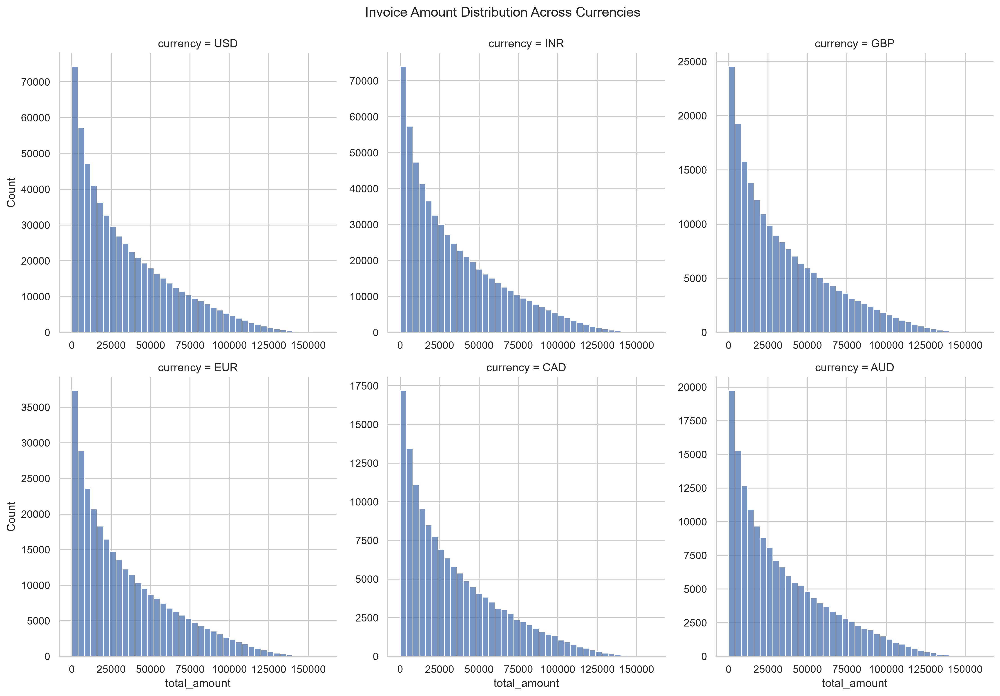

<em>Figure 1: Distribution of invoice amounts across six currencies.</em>

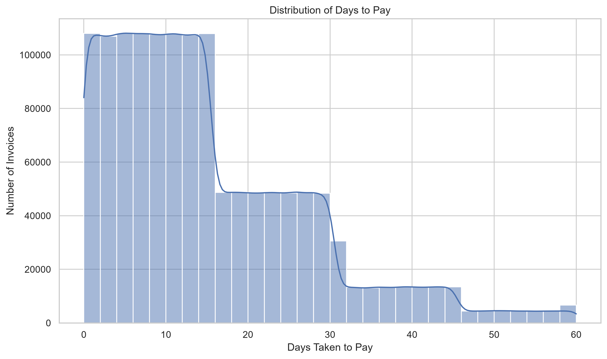

<em>Figure 2: Distribution of days taken to pay verified paid invoices.</em>

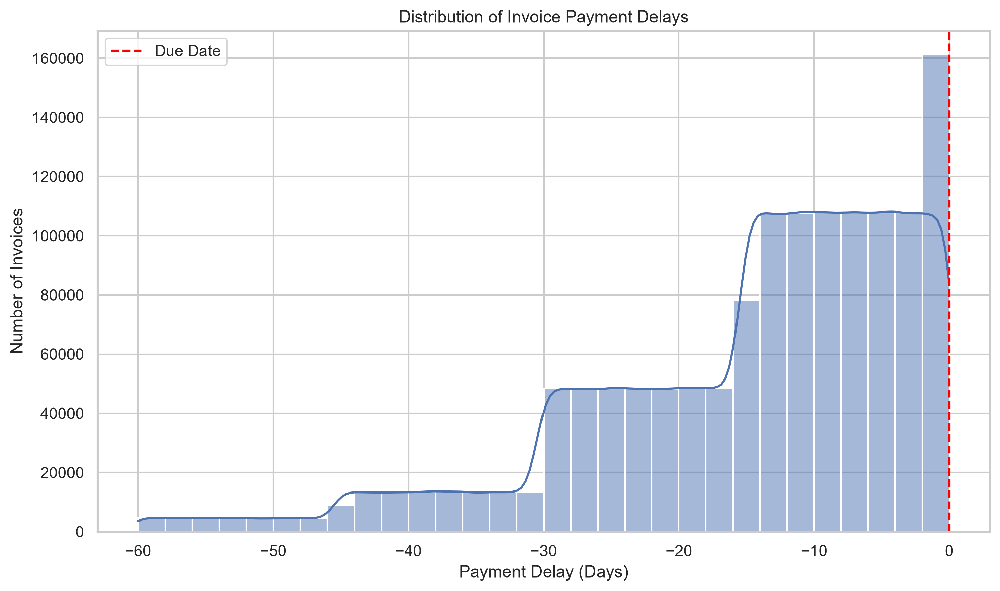

<em>Figure 3: Distribution of payment delays relative to invoice due dates.</em>

### 4.1 Invoice Amount Analysis

The invoice amount distribution was examined using descriptive statistics, histograms and boxplots.

| Statistical Measure | Total Invoice Amount |
|---|---:|
| Mean | 33,979.16 |
| Median | 25,352.21 |
| Standard Deviation | 29,899.39 |
| Minimum | 4.71 |
| First Quartile (Q1) | 9,485.37 |
| Third Quartile (Q3) | 51,494.72 |
| Maximum | 159,936.00 |

The mean is higher than the median, indicating a right-skewed invoice amount distribution.

The numerical invoice amount distributions across the six currencies were also found to be very similar. However, raw amounts in different currencies are not directly comparable in purchasing-power terms.

### 4.2 Verified Payment Behaviour

Payment behaviour was analysed using 1,358,819 invoices with verified payment dates.

| Statistical Measure | Result |
|---|---:|
| Verified Paid Invoices | 1,358,819 |
| Average Days to Pay | 15 days |
| Median Days to Pay | 12 days |
| Minimum Days to Pay | 0 days |
| Maximum Days to Pay | 60 days |
| Average Payment Delay | -15.02 days |

Payment classification:

| Payment Category | Invoice Count | Percentage |
|---|---:|---:|
| Paid Early | 1,305,067 | 96.04% |
| Paid On Time | 53,752 | 3.96% |
| Paid Late | 0 | 0.00% |

The dataset shows predominantly early payment behaviour among verified paid invoices.

Importantly, no verified late-payment examples were found. Therefore, actual late-payment prediction cannot be reliably developed using the current payment outcomes.

---

## 5. Business Overview and Outstanding Invoices

The business overview provides a high-level understanding of invoice settlement and outstanding collection workload.

### 5.1 Payment Status Distribution

| Payment Status | Invoice Count | Percentage |
|---|---:|---:|
| Paid | 1,358,819 | 67.94% |
| Pending | 341,015 | 17.05% |
| Overdue | 199,777 | 9.99% |
| Cancelled | 100,389 | 5.02% |
| **Total** | **2,000,000** | **100%** |

A total of 540,792 invoices, representing 27.04% of all invoices, are classified as outstanding (Pending + Overdue).

Cancelled invoices are excluded from the outstanding invoice calculation.
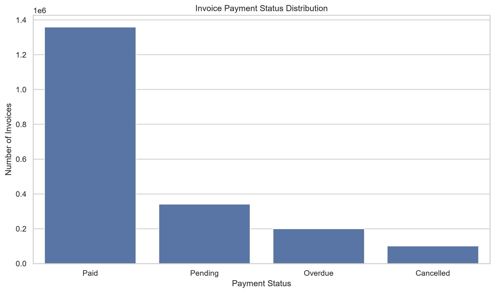

<em>Figure 4: Distribution of invoices across Paid, Pending, Overdue and Cancelled statuses.</em>

### 5.2 Outstanding Amount by Currency

Outstanding invoice amounts were calculated separately for each currency.

| Currency | Outstanding Invoices | Outstanding Amount |
|---|---:|---:|
| AUD | 43,381 | 1,476,760,854.19 |
| CAD | 37,835 | 1,277,526,551.32 |
| EUR | 81,196 | 2,765,968,974.93 |
| GBP | 54,055 | 1,849,014,544.95 |
| INR | 162,031 | 5,510,844,623.91 |
| USD | 162,294 | 5,499,937,955.05 |

**Note:** Amounts are presented in their respective currencies. They have not been combined because currency conversion rates have not been applied.
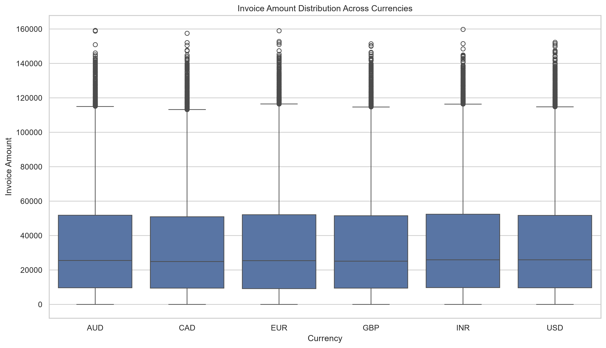

<em>Figure 5: Invoice amount distribution across six currencies.</em>

### 5.3 Past-Due Invoice Analysis

Using 31 December 2025 as a provisional reporting cutoff:

| Metric | Invoice Count |
|---|---:|
| Total Outstanding Invoices | 540,792 |
| Past-Due Outstanding Invoices | 517,906 |
| Not-Yet-Due Outstanding Invoices | 22,886 |

Approximately 95.77% of outstanding invoices were classified as past due based on this reporting date.

The cutoff date is provisional and should be confirmed with the internship mentor or documented as an analytical assumption.
---

## 6. Outstanding Invoice Aging Analysis

Outstanding invoices were grouped into aging categories based on the number of days past their due dates.

The analysis uses 31 December 2025 as a provisional reporting cutoff.

### 6.1 Aging Distribution

| Aging Category | Invoice Count | Percentage |
|---|---:|---:|
| 0–30 Days | 22,298 | 4.31% |
| 31–60 Days | 22,053 | 4.26% |
| 61–90 Days | 22,249 | 4.30% |
| 90+ Days | 451,306 | 87.14% |
| **Total** | **517,906** | **100%** |
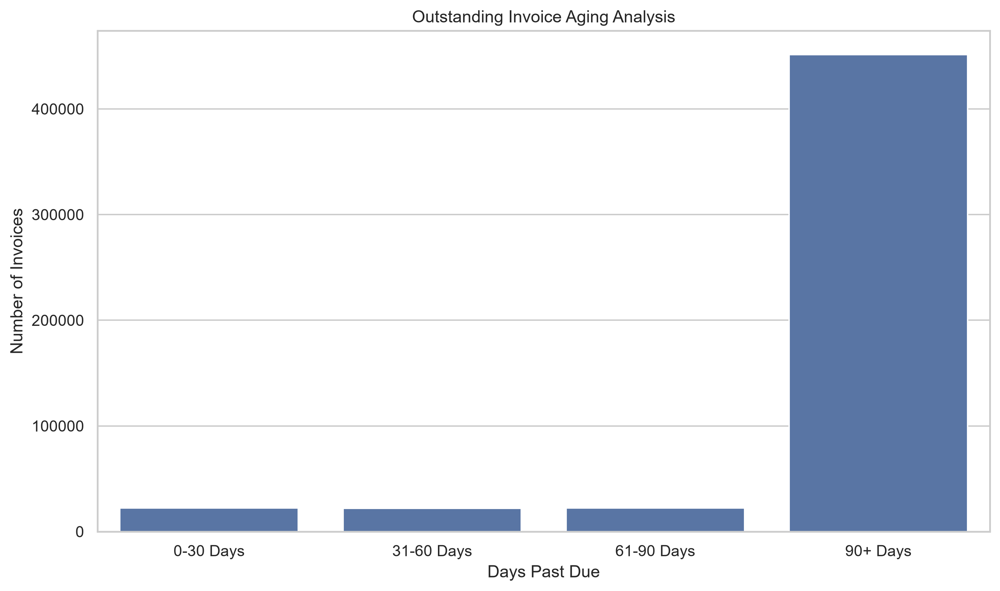

<em>Figure 6: Aging distribution of outstanding past-due invoices as of 31 December 2025.</em>

### 6.2 Business Interpretation

Approximately 87.14% of past-due outstanding invoices fall into the 90+ day aging category.

This indicates a substantial concentration of historical outstanding invoices requiring further investigation and collection attention.

The aging results represent a historical snapshot based on the selected cutoff date. They do not establish whether these invoices were subsequently paid or defaulted.

---

## 7. Key Business Insights and Machine Learning Hypotheses

The following ten insights were identified during the exploratory analysis.

| No. | Business Insight | Key Finding | Potential ML Direction |
|---|---|---|---|
| 1 | Payment Status Distribution | 27.04% of invoices are outstanding. | Predict outstanding invoice probability. |
| 2 | Verified Payment Behaviour | 96.04% were paid early; no verified late payments. | Investigate early vs on-time payment patterns. |
| 3 | Invoice Amount Across Currencies | Numerical invoice amount distributions are similar. | Test currency as a potential feature. |
| 4 | Customer Payment Behaviour | 60,000 customer IDs have repeat invoices. | Explore customer-level payment history features. |
| 5 | Outstanding Invoice Analysis | 540,792 invoices are outstanding. | Estimate outstanding invoice risk. |
| 6 | Invoice Aging Analysis | 87.14% of past-due invoices are 90+ days old. | Develop collection-priority classification. |
| 7 | Amount vs Payment Delay | Correlation is approximately zero. | Evaluate invoice amount alongside other features. |
| 8 | Country-wise Payment Behaviour | Early payment shares are similar across countries. | Test the predictive value of country. |
| 9 | Monthly Payment Trends | Payment timing is relatively stable after March 2024. | Evaluate time-related features. |
| 10 | Numerical Feature Correlation | Invoice financial components show strong correlations. | Evaluate relevant financial features while preventing data leakage. |

### Overall Interpretation

The analysis reveals useful patterns in invoice status, payment timing, customer activity, outstanding balances and invoice aging.

However, the dataset contains no verified late-payment examples among paid invoices. Consequently, a reliable supervised model for predicting actual late payments cannot be trained from the current verified payment outcomes.

Future modelling should use additional representative data with verified early, on-time and late payment outcomes.
---
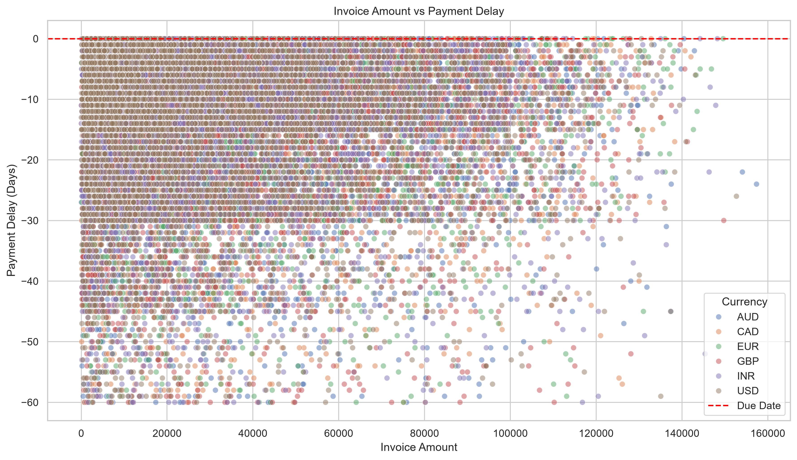

<em>Figure 7: Relationship between invoice amount and payment delay.</em>

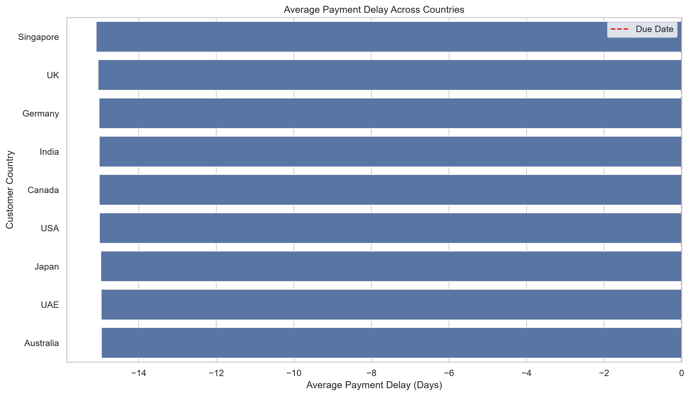

<em>Figure 8: Average payment delay across customer countries.</em>

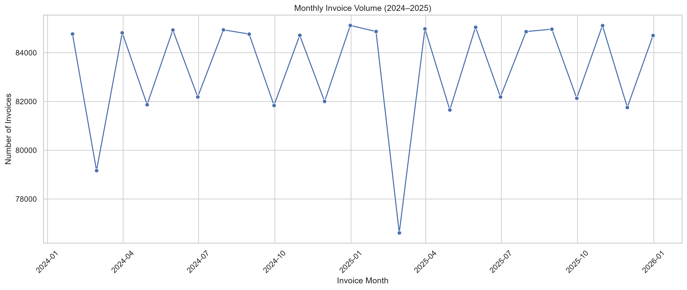

<em>Figure 9: Monthly invoice volume from January 2024 to December 2025.</em>

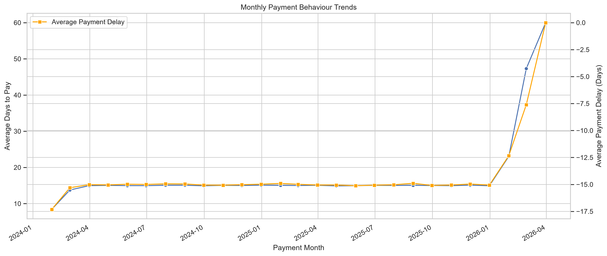

<em>Figure 10: Monthly trends in verified payment behaviour.</em>

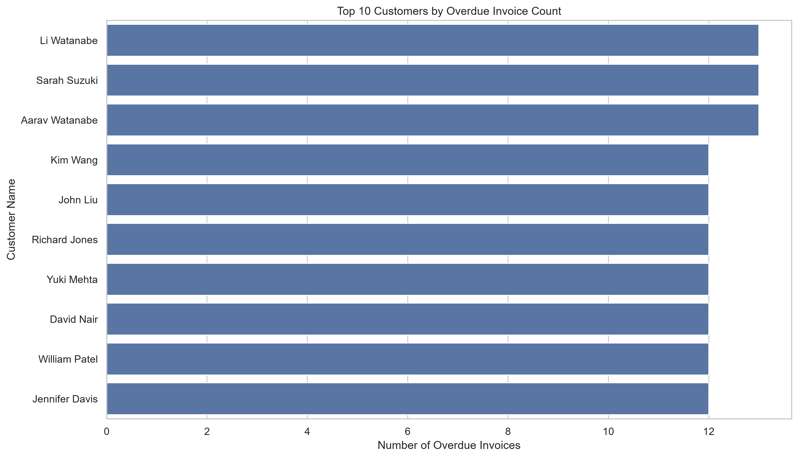

<em>Figure 11: Customers with the highest counts of Overdue-status invoices.</em>

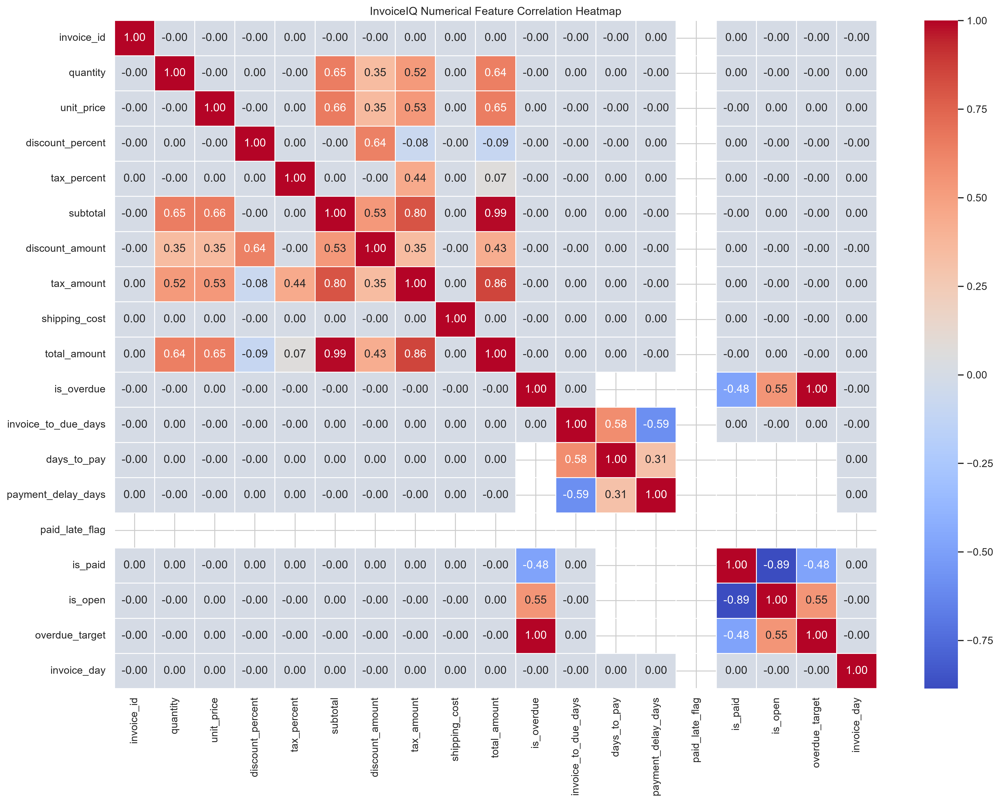

<em>Figure 12: Correlation between numerical invoice features.</em>

## 8. Data Limitations and Analytical Considerations

The following limitations were identified during the exploratory analysis:

1. **No verified late-payment examples:** All verified paid invoices were paid either early or on their due dates. Actual late-payment prediction cannot be validated using the current data.

2. **Unverified payment dates for unpaid invoices:** Payment dates for Pending, Overdue and Cancelled records were not treated as actual payment dates. Only verified paid invoice dates were used for payment-duration calculations.

3. **Provisional aging cutoff:** The aging analysis uses 31 December 2025 as a provisional reporting date. This assumption should be confirmed or documented.

4. **Currency comparison:** Invoice amounts across different currencies were analysed separately. No direct aggregation was performed without currency conversion.

5. **Customer identification:** Customer ID was used as the primary customer identifier because customer names were associated with multiple IDs.

6. **Potential synthetic-data patterns:** Highly consistent payment patterns across countries and customers should be investigated before drawing conclusions about real-world business behaviour.

7. **Machine learning limitations:** Future models require carefully selected target variables, representative outcome examples and features available at the time of prediction.

8. **Data leakage prevention:** Payment dates, days to pay and payment delay must not be used as input features when predicting payment outcomes before payment occurs.

---
## 9. Conclusion

The Week 2 Exploratory Data Analysis provided insights into invoice payment behaviour, customer patterns, outstanding invoices, payment trends and numerical relationships.

Key findings include:
- 67.94% of invoices are marked Paid, while 27.04% remain outstanding.
- Among verified paid invoices, 96.04% were paid early and 3.96% on time.
- No verified late payments were identified in the dataset.
- 87.14% of past-due outstanding invoices fall into the 90+ days aging category as of the provisional cutoff date of 31 December 2025.
- Invoice amount showed almost no linear relationship with payment delay.

The analysis also identified limitations in the payment data that must be addressed before developing a reliable late-payment prediction model.

## 10. Project Deliverables

- EDA notebook: `InvoiceIQ_Week2_EDA.ipynb`
- EDA report: `InvoiceIQ_Week2_EDA_Report.pdf`
- Twelve supporting visualisations included in the notebook and report.
- GitHub repository: [InvoiceIQ – GitHub](https://github.com/paldipesh7-hub/InvoiceIQ)
