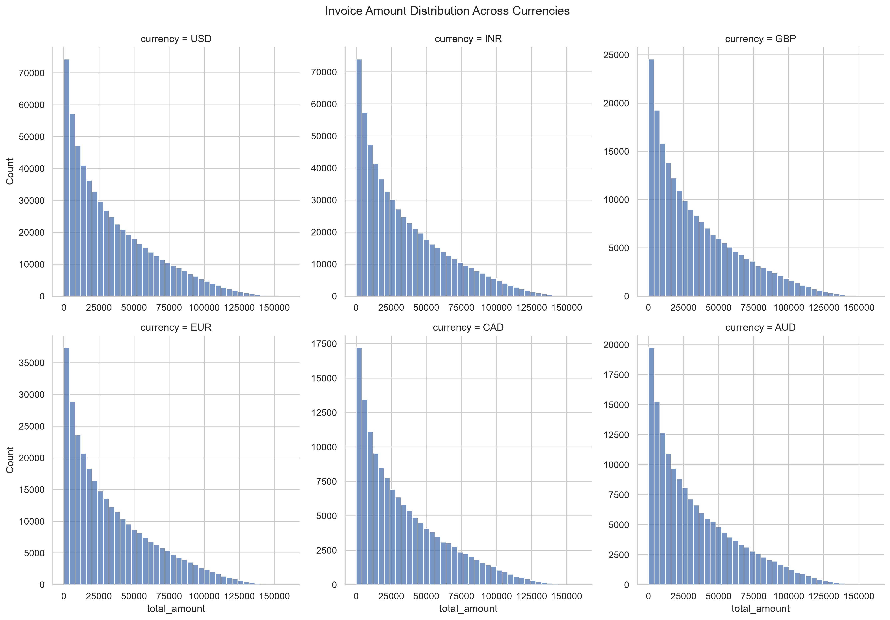
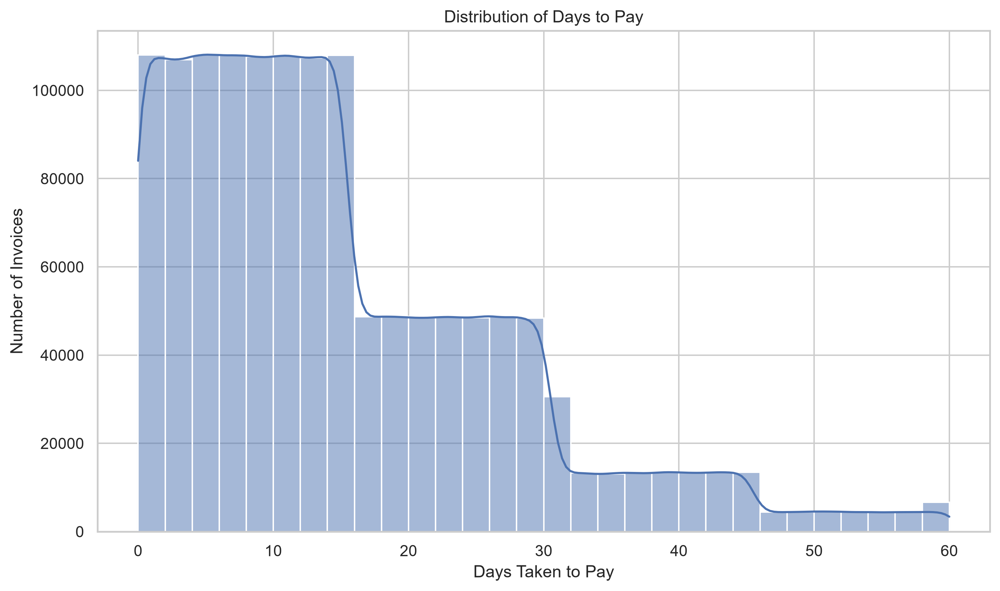
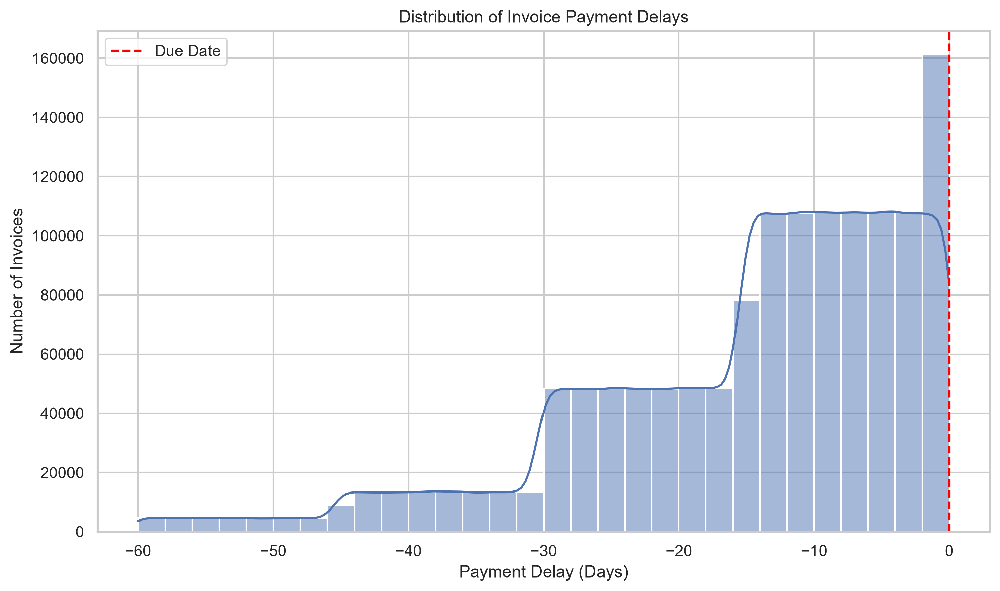
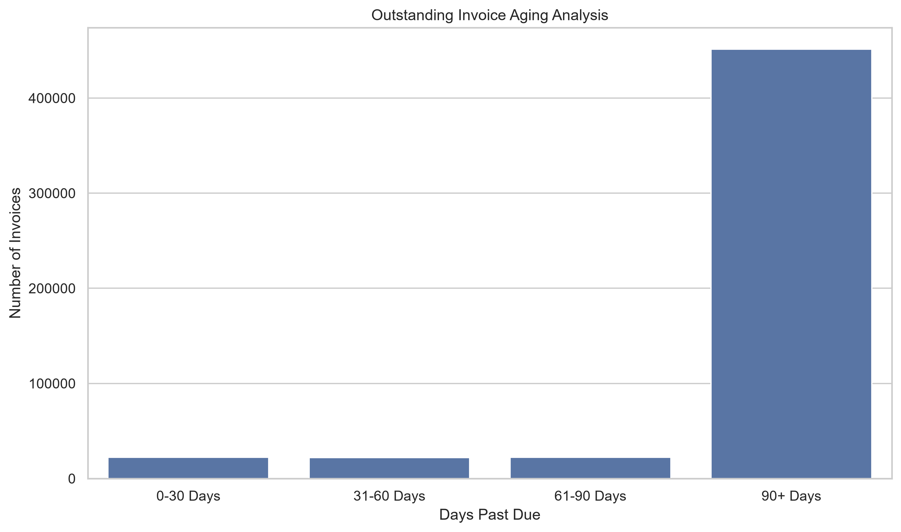
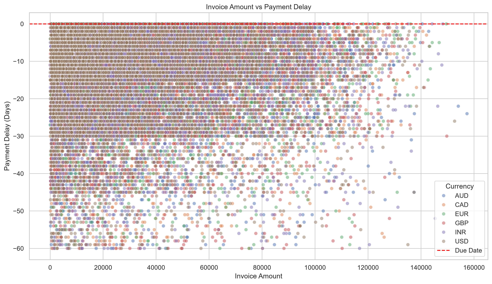
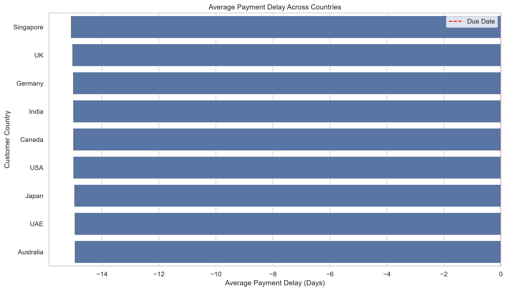
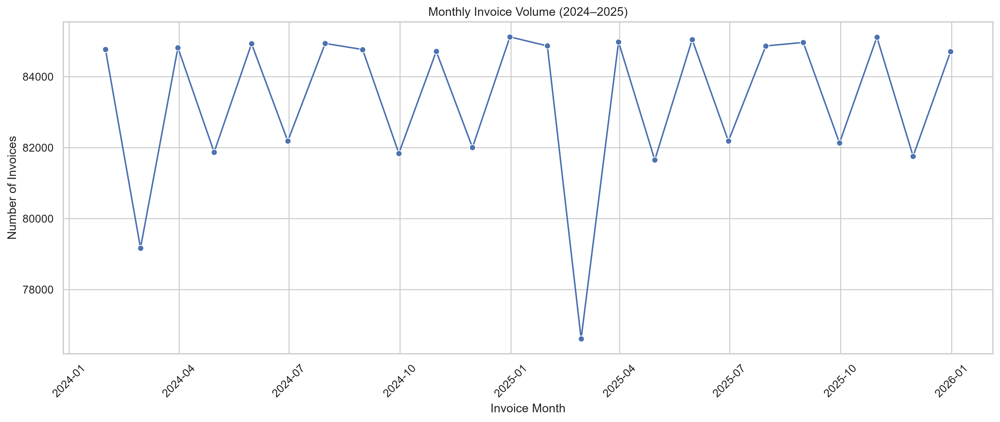
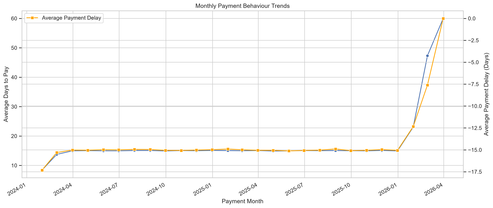
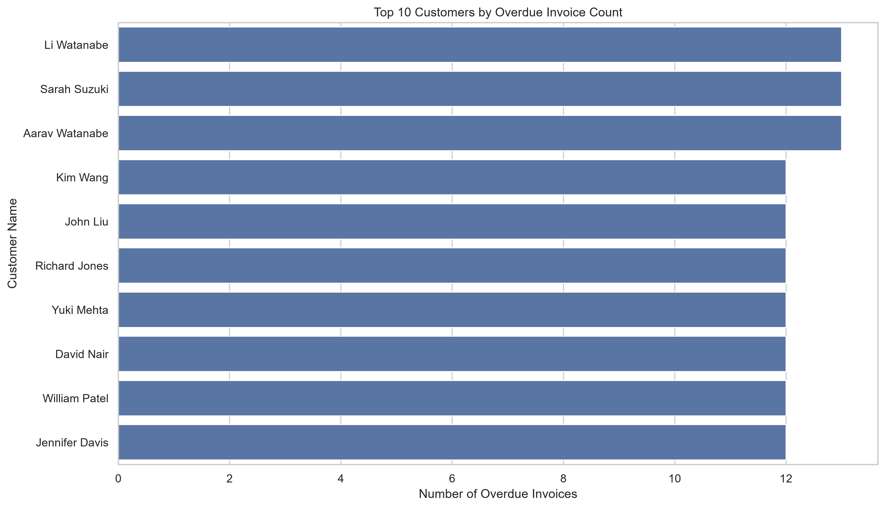
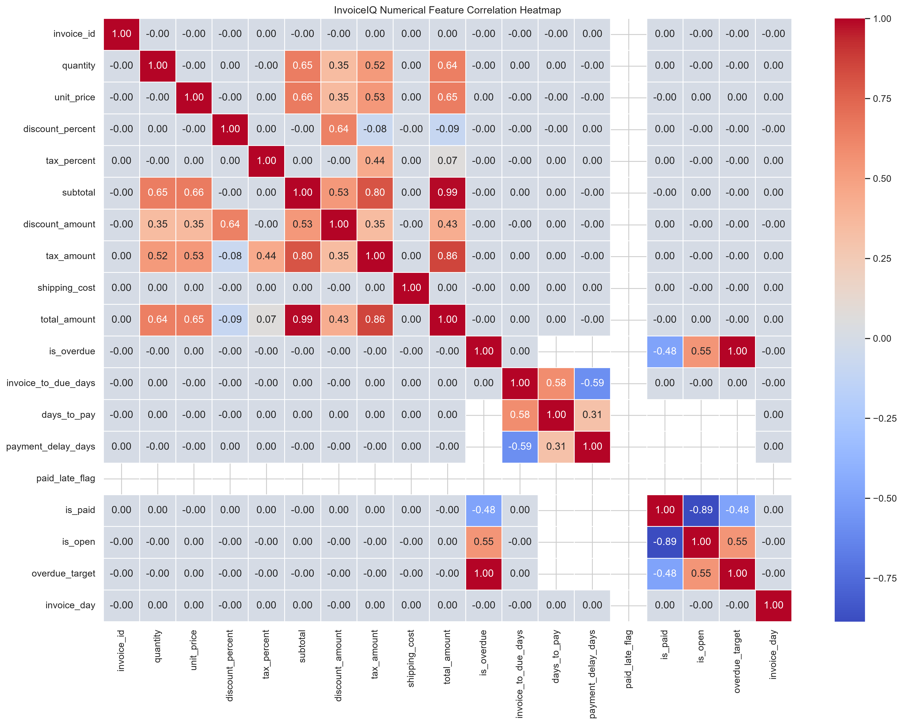

# InvoiceIQ
## Week 2 – Exploratory Data Analysis (EDA) Report

**Project:** Invoice Payment Delay & Cash-Flow Intelligence Platform  
**Prepared by:** Dipesh Raghunath Pal  
**Analysis Period:** January 2024 – December 2025  
**Dataset Size:** 2,000,000 invoice records  
**Tools:** Python, Pandas, NumPy, Matplotlib, Seaborn

---

## 1. Executive Summary

This report presents an exploratory analysis of a global B2B invoice and payments dataset containing 2 million records. The objective is to understand invoice payment behaviour, identify outstanding receivables, examine customer payment patterns and discover business insights that can support future machine learning development.

### Key Findings

- 67.94% of invoices are marked Paid.
- 27.04% of invoices remain outstanding (Pending + Overdue).
- Among verified paid invoices, 96.04% were paid early and 3.96% on time.
- No verified late payments were identified.
- 87.14% of past-due outstanding invoices fall into the 90+ days aging category as of the provisional cutoff date of 31 December 2025.
- Invoice amount showed almost no linear relationship with payment delay.

**Important:** The dataset contains no verified late-payment examples. Therefore, a reliable supervised model for predicting actual late payments cannot be trained from the available payment outcomes without additional representative data.
---

## 2. Dataset Description

**Dataset Source:** [Global B2B Invoice and Payments Dataset – Kaggle](https://www.kaggle.com/datasets/tharishreddy22/global-b2b-invoice-and-payments-dataset)

| Attribute | Description |
|---|---|
| Total records | 2,000,000 |
| Original columns | 31 |
| Columns after feature engineering | 39 |
| Customer IDs | 60,000 |
| Unique customer names | 1,500 |
| Currencies | INR, USD, EUR, GBP, AUD, CAD |
| Invoice date range | Jan 2024 – Dec 2025 |
| Verified payment date range | Jan 2024 – Mar 2026 |

The dataset contains invoice identifiers, customer information, invoice dates, due dates, payment status, payment dates, quantities, pricing, discounts, taxes and currency information.

### Data Quality and Preparation

- No completely duplicated records or duplicate invoice IDs were identified.
- No missing values were found in the original dataset fields.
- Missing verified payment dates in unpaid records were intentional.
- Date columns were converted into datetime format.
- Non-paid records were excluded from actual payment-duration calculations.
- Six currencies were analysed separately to avoid misleading cross-currency comparisons.

## 3. EDA Methodology

The analysis followed these steps:

1. Dataset loading and structural inspection.
2. Data type, missing-value and duplicate checks.
3. Descriptive statistics and invoice amount distribution.
4. Verified payment-duration and payment-delay analysis.
5. Country, customer and monthly trend analysis.
6. Outstanding invoice and aging analysis.
7. Numerical correlation analysis.
8. Business insight identification and ML hypothesis development.

### Important Derived Metrics

| Metric | Definition |
|---|---|
| Days to Pay | Payment Date − Invoice Date |
| Payment Delay | Payment Date − Due Date |
| Early Payment | Payment Delay below 0 |
| On-Time Payment | Payment Delay equal to 0 |
| Late Payment | Payment Delay above 0 |
| Outstanding Invoice | Pending or Overdue status |

Actual payment metrics were calculated using verified payment dates only. Unpaid records were not treated as completed payments.
---

## 4. Statistical Analysis

### Invoice Amount Distribution

| Statistic | Total Amount |
|---|---:|
| Mean | 33,979.16 |
| Median | 25,352.21 |
| Standard deviation | 29,899.39 |
| Minimum | 4.71 |
| First quartile (Q1) | 9,485.37 |
| Third quartile (Q3) | 51,494.72 |
| Maximum | 159,936.00 |

The mean is higher than the median, indicating a right-skewed invoice amount distribution. Invoice amounts showed broadly similar distributions across the six currencies, although their purchasing power is not directly comparable.

<em>Figure 1: Invoice amount distribution across six currencies.</em>

<em>Figure 2: Distribution of days taken to pay verified paid invoices.</em>

<em>Figure 3: Distribution of payment delays relative to invoice due dates.</em>

 Verified Payment Behaviour

Analysis of 1,358,819 verified paid invoices produced the following results:

| Metric | Result |
|---|---:|
| Average days to pay | 15.00 days |
| Median days to pay | 12 days |
| Minimum days to pay | 0 days |
| Maximum days to pay | 60 days |
| Average payment delay | -15.02 days |

| Payment Behaviour | Invoices | Share |
|---|---:|---:|
| Early | 1,305,067 | 96.04% |
| On time | 53,752 | 3.96% |
| Late | 0 | 0% |

**Business interpretation:** The available verified payment records show predominantly early payments. However, the absence of late-payment examples limits the dataset's suitability for training an actual late-payment prediction model.
---
## 5. Business Overview and Outstanding Invoices

### Invoice Payment Status

| Payment Status | Invoice Count | Percentage |
|---|---:|---:|
| Paid | 1,358,819 | 67.94% |
| Pending | 341,015 | 17.05% |
| Overdue | 199,777 | 9.99% |
| Cancelled | 100,389 | 5.02% |
| **Total** | **2,000,000** | **100%** |

### Outstanding Receivables

A total of **540,792 invoices (27.04%)** were classified as outstanding, comprising Pending and Overdue invoices.

Outstanding invoice values by currency:

| Currency | Outstanding Invoices | Outstanding Amount |
|---|---:|---:|
| AUD | 43,381 | 1,476,760,854.19 |
| CAD | 37,835 | 1,277,526,551.32 |
| EUR | 81,196 | 2,765,968,974.93 |
| GBP | 54,055 | 1,849,014,544.95 |
| INR | 162,031 | 5,510,844,623.91 |
| USD | 162,294 | 5,499,937,955.05 |

Amounts are reported in their original currencies and have not been combined.

### Past-Due Analysis

Using a provisional reporting cutoff of **31 December 2025**:

- Outstanding invoices: 540,792
- Past-due invoices: 517,906
- Not-yet-due outstanding invoices: 22,886
- Past-due share of outstanding invoices: 95.77%

These figures represent a historical aging snapshot. The cutoff date should be confirmed with the project mentor before final business use.
---
## 6. Customer and Time-Based Analysis

### Customer Behaviour

The dataset contains 60,000 unique customer IDs, and all customers have multiple invoices.

The highest invoice count recorded for an individual customer was 59 invoices. The highest Overdue-status count for an individual customer was 13 invoices.

The analysis identified differences in customer payment duration. For example, the customer with ID CUST-032595 had an average of 29.14 days to pay across 14 verified paid invoices.

These findings can support future customer segmentation and payment-behaviour analysis. Overdue-status counts should not be interpreted as independently verified late payments.

### Country-Based Payment Behaviour

Verified payment behaviour was broadly consistent across all nine customer countries.

- Average days to pay remained approximately 15 days.
- Average payment delay remained approximately 15 days early.
- Early-payment percentages were approximately 95.87%–96.09%.
### Monthly Invoice Trends

Invoice volume remained relatively stable across the 24 months from January 2024 to December 2025, ranging from approximately 76,615 to 85,121 invoices per month.

Month-end and quarter-end invoice activity showed negligible differences in average daily volume.
## 7. Outstanding Invoice Aging Analysis

Past-due outstanding invoices were grouped using the provisional cutoff date of 31 December 2025.

| Aging Bucket | Invoice Count | Percentage |
|---|---:|---:|
| 0–30 days | 22,298 | 4.31% |
| 31–60 days | 22,053 | 4.26% |
| 61–90 days | 22,249 | 4.30% |
| 90+ days | 451,306 | 87.14% |
| **Total** | **517,906** | **100%** |

<em>Figure 4: Aging distribution of outstanding past-due invoices as of 31 December 2025.</em>

**Business interpretation:** The large concentration of invoices in the 90+ days bucket indicates that historical outstanding receivables are heavily concentrated in older past-due records. This warrants further investigation, but does not independently establish customer default.

<em>Figure 5: Relationship between invoice amount and payment delay.</em>

<em>Figure 6: Average payment delay across customer countries.</em>

<em>Figure 7: Monthly invoice volume from January 2024 to December 2025.</em>

<em>Figure 8: Monthly trends in verified payment behaviour.</em>

<em>Figure 9: Customers with the highest counts of Overdue-status invoices.</em>

<em>Figure 10: Correlation between numerical invoice features.</em>

  8. Correlation Analysis

The numerical correlation analysis identified the following relationships:

| Feature Relationship | Correlation |
|---|---:|
| Subtotal and Total Amount | +0.99 |
| Tax Amount and Total Amount | +0.86 |
| Subtotal and Tax Amount | +0.80 |
| Unit Price and Subtotal | +0.66 |
| Quantity and Subtotal | +0.65 |
| Invoice-to-Due Days and Days to Pay | +0.58 |
| Invoice-to-Due Days and Payment Delay | -0.59 |
| Days to Pay and Payment Delay | +0.31 |

Invoice amount and payment delay showed almost no linear correlation across currencies.

Correlation does not establish causation. Payment-duration and payment-delay features are calculated using actual payment dates and must not be used as predictors in a model intended to predict payment outcomes before payment occurs.

## 9. Key Business Insights and ML Hypotheses

| No. | Business Insight | Potential ML Application |
|---:|---|---|
| 1 | 67.94% of invoices are Paid. | Payment-status classification |
| 2 | Verified payments are predominantly early. | Payment-duration estimation |
| 3 | Invoice amount distributions are similar across currencies. | Invoice amount analysis |
| 4 | Customer payment duration varies. | Customer segmentation |
| 5 | 27.04% of invoices are outstanding. | Outstanding invoice classification |
| 6 | 87.14% of past-due invoices are 90+ days overdue. | Receivables aging prioritisation |
| 7 | Invoice amount has negligible linear correlation with payment delay. | Feature importance testing |
| 8 | Payment behaviour is broadly consistent across countries. | Geographic feature evaluation |
| 9 | Monthly invoice volume is relatively stable. | Invoice volume forecasting |
| 10 | Invoice amount components show strong correlations. | Financial feature analysis |

**ML feasibility:** These hypotheses require separate validation. The current dataset does not contain verified late-payment outcomes, so actual late-payment prediction requires additional representative labelled data. Payment status can be studied as a separate classification target, with appropriate prevention of target leakage.

## 10. Data Limitations

- No verified positive late-payment examples are available.
- Unpaid records do not contain independently verified actual payment dates.
- The aging analysis uses a provisional reporting cutoff.
- Currency values cannot be directly aggregated across currencies.
- Repeated customer IDs and synthetic-looking patterns require further validation.
- Payment delay and days to pay must be excluded from pre-payment prediction features.

## 11. Conclusion

The Week 2 EDA identified important patterns in payment status, payment duration, customer behaviour, outstanding receivables and invoice aging.

The analysis provides a foundation for future InvoiceIQ development, particularly customer segmentation, outstanding receivables monitoring and payment-status analysis.

However, additional verified payment-history data is required before building a reliable late-payment prediction model.

## 12. Project Deliverables

- EDA notebook: `InvoiceIQ_Week2_EDA.ipynb`
- Submission report: `InvoiceIQ_Week2_Submission_Report.pdf`
- Supporting visualisations: 10 chart images.
- - **GitHub Repository:** [InvoiceIQ – GitHub](https://github.com/paldipesh7-hub/InvoiceIQ)

**Prepared for:** InvoiceIQ – Week 2 Internship Submission
